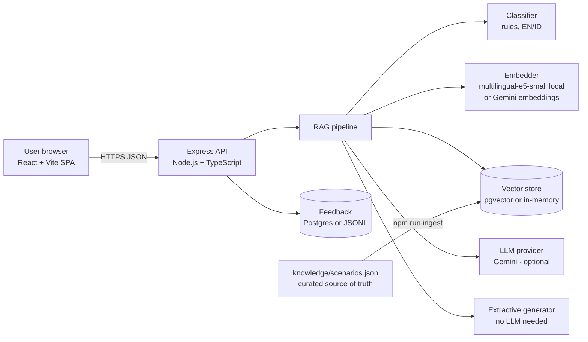
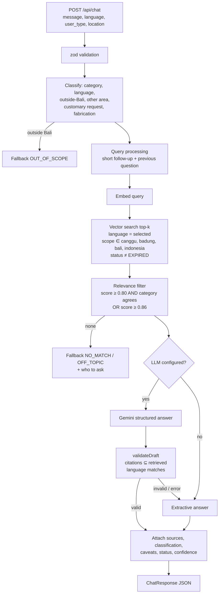
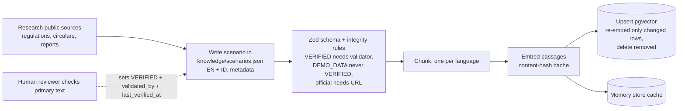
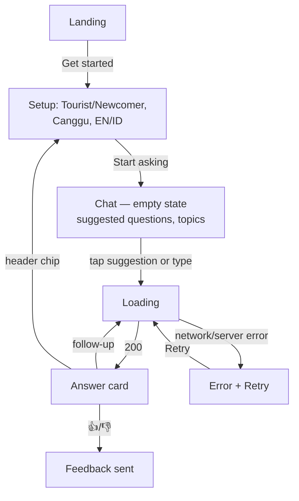
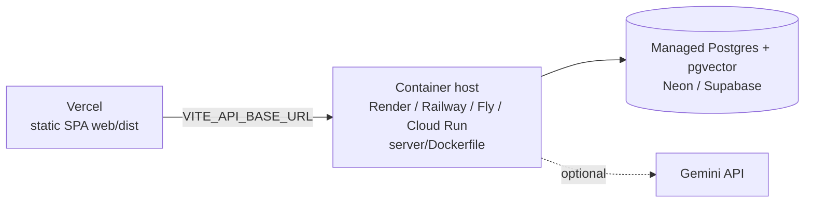

# System Architecture

> **Update 2026-11-05 — knowledge base v2.** The 13 hand-written scenarios described below were retired. The system now uses the knowledge base built from `Database/` (Bali regulations, Desa Adat Canggu pararem and awig-awig, research packs) through a six-stage pipeline, stored in PostgreSQL + pgvector, with EN↔ID query translation and verbatim quotes. Where this document disagrees with [KNOWLEDGE_BASE_V2.md](KNOWLEDGE_BASE_V2.md), **KNOWLEDGE_BASE_V2.md is current**.

## 1. High-level architecture



Components are injected through interfaces (`Embedder`, `VectorStore`, `LlmClient`, `FeedbackStore`), so each can be swapped without touching the pipeline. `src/bootstrap.ts` wires the real implementations from environment variables; tests wire fakes.

## 2. Frontend architecture (`web/`)

- React 18 + TypeScript, Vite 6, Tailwind CSS v4 (`@theme` design tokens in `src/index.css`), lucide-react icons.
- No router: three views managed by `App.tsx` state — `landing → setup → chat`. Settings (language, user type) persist in `localStorage` (wrapped in try/catch).
- `lib/api.ts` — typed fetch client with timeout and typed `ApiError` (network / timeout / server codes).
- `lib/i18n.ts` — all UI strings in EN and ID, source-type and validation labels.
- Components: `Landing`, `Setup`, `Chat` (empty state with suggested questions + categories, loading, error/retry), `AnswerCard` (status, classification, guidance, why, actions, caveats, sources, feedback), `SourceBadge` / `SourceLegend`.
- Dev: Vite proxies `/api` to `localhost:8787`. Prod: `VITE_API_BASE_URL`.

## 3. Backend architecture (`server/`)

```
src/
  index.ts          entry point (listen)
  bootstrap.ts      dependency wiring from config
  app.ts            Express app: routes, zod validation, rate limit, error handler
  config.ts         typed env config
  types.ts          shared domain types and enums
  feedback.ts       FeedbackStore (JSONL file | Postgres)
  db/pool.ts        pg pool
  rag/
    knowledge.ts    load + validate knowledge JSON (zod + integrity rules), chunking
    embeddings.ts   LocalEmbedder (transformers.js), GeminiEmbedder
    vectorStore.ts  VectorStore interface, MemoryVectorStore (+ disk cache)
    pgVectorStore.ts PgVectorStore (search + idempotent upsert)
    classifier.ts   category / language / scope / safety flags
    prompts.ts      system + user prompts for the LLM
    llm.ts          GeminiClient (structured JSON output)
    messages.ts     fixed bilingual fallback & caveat texts
    pipeline.ts     RagPipeline orchestration + validateDraft
  scripts/          migrate.ts, ingest.ts, eval.ts
  eval/scenarios.ts evaluation set (tuning + holdout)
db/migrations/      SQL migrations
```

## 4. Database architecture

PostgreSQL 16 + pgvector. Tables `knowledge_documents` (one row per scenario per language, with `vector(384)` embedding, HNSW cosine index, filter indexes, integrity CHECK constraints), `feedback`, `schema_migrations`. Details in [DATA_MODEL.md](DATA_MODEL.md).

When `DATABASE_URL` is not set, `MemoryVectorStore` loads the same JSON, embeds it (cached on disk under `server/.cache/`) and performs the identical filtered cosine search in process. With 26 chunks this is effectively instantaneous; pgvector is the path for a growing, multi-instance deployment.

## 5. AI architecture

- **Embeddings:** `Xenova/multilingual-e5-small` (384-d, ONNX, q8) running locally on CPU via `@huggingface/transformers`; e5 `query:` / `passage:` prefixes. Optional `gemini-embedding-001`.
- **Generation:** Gemini (`gemini-2.5-flash` default) with a JSON response schema, temperature 0.2. Without a key, a deterministic extractive generator quotes the top document.
- **Guardrails:** classifier flags (outside Bali, other Bali areas, customary-rule requests, fabrication attempts), relevance gate, citation validation, language validation, caveat generation. See [AI_IMPLEMENTATION.md](AI_IMPLEMENTATION.md).

## 6. RAG workflow



## 7. Knowledge ingestion pipeline



## 8. API integration

Endpoints: `POST /api/chat`, `GET /api/knowledge/categories`, `GET /api/health`, `POST /api/feedback`. Full contract in [API_DOCUMENTATION.md](API_DOCUMENTATION.md).

## 9. User interaction flow



## 10. Data flow

1. Browser sends the question plus context (no identifiers other than a random conversation UUID).
2. Server keeps the last 6 turns per conversation in memory (max 500 conversations, LRU) purely to resolve short follow-ups; nothing is written to disk except optional feedback.
3. With an LLM configured, the question and the retrieved source texts are sent to the Gemini API.

## 11. Error handling

| Layer | Handling |
|---|---|
| Input | zod → `400 VALIDATION_ERROR` with field details; bad JSON → `400 INVALID_JSON`; > 16 kB → `413` |
| Rate limit | 30 req/min/IP on `/api/*` → `429 RATE_LIMITED` |
| LLM | timeout (20 s), HTTP errors, unparsable JSON, missing/invalid citations, wrong language → logged and replaced by extractive answer (user still gets a grounded answer) |
| Vector store | errors → `500 INTERNAL_ERROR` (generic message, details only in server log); `/api/health` returns `503 degraded` |
| Frontend | typed `ApiError`; error bubble with Retry; feedback failure shown inline |

## 12. Security considerations

See [SECURITY.md](SECURITY.md).

## 13. Deployment architecture



Details in [DEPLOYMENT.md](DEPLOYMENT.md).

## 14. Technical trade-offs

| Decision | Why | Cost |
|---|---|---|
| Local e5-small embeddings | Works with no key; real multilingual semantic search; testable | ~120 MB model download, ~3 min first ingest, CPU latency; compressed score range |
| Extractive mode without LLM | Always grounded, zero hallucination, zero cost | Answers are quoted text, less conversational, cannot combine sources |
| Rule-based classifier | Deterministic, explainable, testable, no extra model | Vocabulary-limited — main cause of holdout misses |
| Category-agreement relevance gate | e5 alone cannot separate off-topic queries (~0.82 for unrelated text) | Rejects valid questions phrased with unseen words (fails safe) |
| One chunk per scenario per language | Scenarios are short; cleaner citations | Doesn't scale to long legal texts without a chunker |
| JSON as source of truth + ingest | Reviewable in git, diffable, easy to verify | Not an editing UI for non-technical reviewers |
| In-memory conversation history | Simple, private | Lost on restart; not shared across instances |
